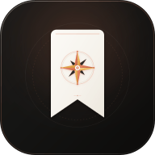

# ✨ Memo — 個人智慧生活記錄庫 (Smart Life Curation & AI Parser)

  

  <strong>100% 免費、開源、零伺服器開銷！為日常靈感、美食食譜、踩點景點與影視清單打造的私有 AI 記錄庫。</strong>

  
  
  
  
  

---

## 🌟 為什麼選擇 Memo？

- 💰 **真正 $0 零花費**：不需綁定信用卡、不需租用任何雲端資料庫（如 Upstash Redis），資料 100% 存於本機 `.data/db.json`。
- 🪄 **免開終端機、免碰程式碼**：內建雙系統「點兩下啟動」腳本與「網頁版金鑰精靈」，連 `.env` 都不用手動找！
- 🔒 **極致隱私保護**：所有收集的貼文、踩點足跡與私廚菜單全存於本機電腦，無任何第三方窺探。
- 📱 **iOS 捷徑無縫整合**：在 iPhone 或 iPad 的 Safari、Instagram、Threads、YouTube 點擊「分享」，一秒將靈感送進 Memo。
- 🗑️ **一鍵乾淨刪除**：附帶「停止服務腳本」，一鍵釋放連接埠與關閉進程，拖進垃圾桶即可乾淨移除，絕不殘留後台垃圾！

---

## 🚀 3 步驟極速上手（新手友善）

### 步驟 1：下載專案
點擊 GitHub 右上方綠色按鈕 **`Code` -> `Download ZIP`**，解壓縮至您的電腦（例如桌面）。

### 步驟 2：點兩下啟動
進入解壓縮後的資料夾，直接雙擊對應您作業系統的啟動腳本：

| 作業系統 | 啟動腳本 | 說明 |
| :--- | :--- | :--- |
| **🍎 macOS** | **`🚀 點兩下啟動 Memo (Mac).command`** | 初次執行會自動安裝依賴並於 3 秒內自動在瀏覽器開啟 |
| **🪟 Windows** | **`🚀 啟動 Memo (Windows).bat`** | 自動檢查 Node 環境、安裝套件並啟動服務 |

> [!NOTE]
> 電腦需安裝有 **[Node.js](https://nodejs.org/)** (LTS 穩定版本)。若您的電腦尚未安裝，腳本會貼心提示您官方下載連結。

### 步驟 3：在網頁上貼上免費 Gemini API Key
啟動後瀏覽器會自動開啟 `http://localhost:3000`。
首次載入時，網頁會自動跳出「**設定精靈**」：
1. 點擊彈窗中的 **「👉 點此免費領取 Google Gemini API Key」**。
2. 登入 Google 帳號並取得免費金鑰（開頭為 `AIzaSy...`）。
3. 將金鑰貼入網頁框中，點擊 **「測試連線並儲存」**。
4. 🎉 大功告成！立即開始享受強大的 AI 智慧生活記錄！

---

## 🔑 如何 30 秒免費申請 Google Gemini API Key？

Google 為所有 Google 帳號提供極度大方的免費額度（完全無需綁定信用卡）：

1. 前往 **[Google AI Studio (aistudio.google.com/app/apikey)](https://aistudio.google.com/app/apikey)**。
2. 登入您的個人 Google 帳號。
3. 點擊 **「Create API key」**（建立 API 金鑰）。
4. 選擇任意專案或點擊快速建立，即可複製金鑰代碼（例如：`AIzaSyD...`）。
5. 回到 Memo 網頁彈窗貼上即可！

> [!TIP]
> Google AI Studio 提供的免費額度為 **每分鐘 15 次請求 (RPM)**，個人每天收集數十至數百篇貼文與問答完全在免費配額內，$0 永久暢用。

---

## 💡 核心亮點功能

### 1. 貼上網址，AI 自動圖文解析
只需複製 Instagram 貼文、Threads 串文、YouTube 影片、小紅書或大眾食譜網址並貼入 Memo，Gemini AI 會自動：
- 萃取高畫質清晰縮圖與封面。
- 自動研判項目類型（景點、食譜、電影影劇、購物好物、一般靈感）。
- 智慧歸納 3 點精華摘要，不用點進原文就能掌握重點。

### 2. 私房食譜料理換算
- **食材清單自動表格化**：自動提煉調味料與食材克數。
- **動態人數倍率換算**：點選 1人、2人、4人，食材份量立即等比自動計算。
- **超市採買推車**：勾選想煮的多道料理，AI 自動合併同類食材並產出購物清單。

### 3. 踩點景點地圖與一日遊排程
- 自動識別店家中文名稱、標準縣市行政區與經緯度座標。
- 內建台灣縣市多層級篩選與互動地圖標記。
- **一鍵 AI 順路行程**：勾選想去的景點，AI 自動依騎車或開車順路路線安排最佳遊玩順序。

### 4. 電影與影劇時刻追蹤
- 貼上影評或預告片，自動串接 IMDb 評分、首映年份與官方直式高清海報。
- 自動查詢台灣 3 大串流平台（Netflix、Disney+、HBO/Max）上架現況。

### 5. AI 生活靈感問答 (Ask AI)
點擊頂部問答框，直接對您的個人收藏庫對話：
- *「推薦我這週末適合去台北喝咖啡、氣氛安靜的店？」*
- *「冰箱只剩下雞胸肉和洋蔥，我收藏過哪些符合的食譜？」*
- *「我想看評分高於 8 分的懸疑推理電影。」*

---

## 📱 iPhone / iPad 捷徑設定指南

Memo 支援透過 Apple「捷徑 (Shortcuts)」 App 實現全自動分享存入：

1. 用 iPhone 或 iPad 打開 Memo 網頁（例如區網 IP `http://192.168.x.x:3000/memo`）。
2. 進入 **「⚙️ 設定 > 📱 iPhone 捷徑安裝」**。
3. 點擊 **「下載專屬捷徑檔案」**，系統將自動配置連回您電腦的專屬快捷方式。
4. 以後在 IG、Threads 或 Safari 瀏覽任何網頁時，點擊 **「分享」->「存入 Memo」**，貼文就會在背景悄悄存入您的生活庫！

---

## 🗑️ 如何 100% 乾淨卸載？

如果您想釋放空間或不再使用 Memo，只需兩步：

1. 雙擊執行資料夾內的停止腳本：
   - **Mac**：雙擊 **`🗑️ 停止並準備刪除 Memo (Mac).command`**
   - **Windows**：雙擊 **`🗑️ 停止服務 (Windows).bat`**
2. 看到視窗提示 `✅ 背景服務已完全關閉，沒有任何系統殘留！` 後，直接將整份 `Memo-OpenSource` 資料夾**拖進垃圾桶清空**即可！
   *Memo 不會在全域系統環境寫入任何常駐服務或註冊表，100% 潔淨無殘留。*

---

## 🛠️ 技術棧架構

- **前端框架**：Next.js 16 (App Router) + React 19 + TypeScript
- **樣式引擎**：Tailwind CSS v4 (現代 CSS 變數主題架構)
- **AI 整合**：官方 `@google/genai` SDK + 多模型智能備援鏈 (Fallback Chain)
- **本機資料庫**：輕量級本機 JSON 儲存庫 (`.data/db.json` & `.data/config.json`)
- **圖標庫**：Lucide React Icons

---

## 📄 開源授權

本專案採用 [MIT License](./LICENSE) 開源授權。歡迎自由修改、客製化或進行二次開發！
